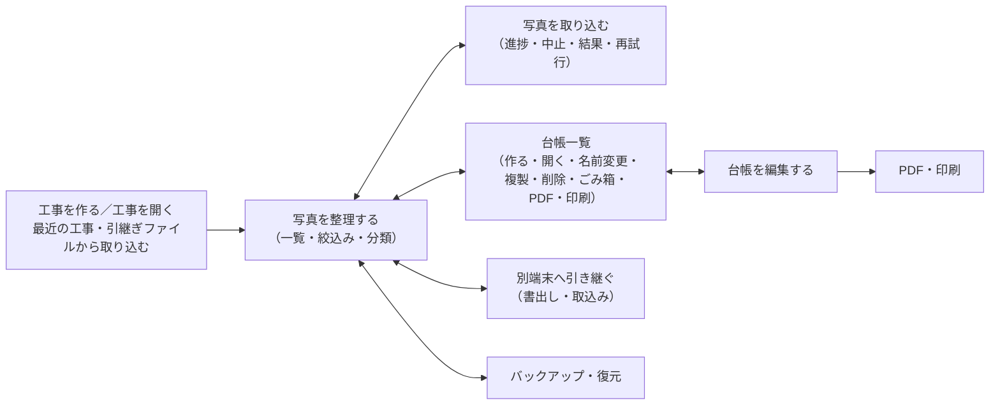

# aoALB 2 ローカル版 設計書（段階1）

状態：段階1（設計）完了・段階2（最小プロトタイプ）実装済み。段階3以降は未着手。
位置付け：**写真の取込み・整理・台帳作成・PDF出力・別端末への手動引継ぎができる、個人用ローカル写真台帳アプリ**（Windows）。
ログイン・クラウド・月額サービスは使わない。クラウド案は [`docs/aoalb2/future-cloud/`](../../docs/aoalb2/future-cloud/README.md) に将来案として保管。

## 1. 方針変更で変えたこと

| 項目 | 旧設計（クラウド案） | 新設計（ローカル版） |
|---|---|---|
| 正本 | Supabase（Postgres・Storage） | 利用者が選んだ工事フォルダ内の SQLite と原寸ファイル |
| 利用者 | 複数・招待制・役割 | 1人（ログインなし） |
| 同期 | Realtime＋変更番号の差分取得 | なし。工事全体を `.aoalb` ファイルで手動引継ぎ |
| 競合 | 自動適用＋利用者判断 | 自動マージしない。新しい編集がある端末への取込みは警告して止める |
| 配布 | Webアプリ（GitHub Pages） | Windowsデスクトップアプリ（Tauri） |
| 費用 | Free／Pro の判断が必要 | 0円（端末のディスクのみ） |
| 引き継いだ設計 | 操作単位（op）保存、変更した枠だけ更新、元分類と上書きの分離、ソフトデリート、技術用語を画面に出さない | 同左 |

## 2. 技術選定

| 観点 | **Tauri 2（採用）** | Electron | PWA（ブラウザのみ） | .NET（WPF/WinUI） |
|---|---|---|---|---|
| 配布サイズ | 約5〜10MB（WebView2はWindows標準） | 約100MB | 0（URL） | 約30〜60MB |
| メモリ | 中核40〜80MB＋WebView | 150〜300MB | ブラウザ依存 | 小 |
| ファイル操作 | Rustで直接・ストリーム処理 | Node.jsで直接 | File System Access API（Chrome/Edgeのみ、再許可が必要） | 直接 |
| 保存領域 | 工事フォルダ（ブラウザに依存しない） | 同左 | ブラウザ保存領域・許可に依存（要件に反する） | 同左 |
| PDF | Rustで原寸JPEGを無変換埋込み | JSライブラリ | JSライブラリ（メモリ制約大） | ネイティブ |
| 更新 | 公式アップデーター（署名付き） | electron-updater | 自動 | ClickOnce等 |
| 将来のiPad | Tauri 2 は iOS に対応。画面（Web技術）と中核（Rust）を再利用可能 | 不可 | 可能だがファイル操作が弱い | 不可 |
| 画面の再利用 | Web技術 | Web技術 | Web技術 | 不可 |

採用理由：要件（ブラウザ保存領域に依存しない・原寸を全件メモリへ載せない・JPEG無変換PDF・将来のWeb/iPad）を最も小さい配布物で満たせるため。

## 3. 構成（画面と保存処理の分離）

```
画面（app/ui：HTML/CSS/JS、ビルド不要）
  ├─ 台帳モデル ledger-model.js（即時反映・元に戻す／やり直す。保存先に依存しない）
  ├─ 自動保存キュー save-queue.js（700msでまとめて1回、保存は常に1本、再試行上限あり）
  └─ Repository インターフェース repository.js
        ├─ 現在：TauriRepository → Tauriシェル（app/src-tauri）→ 中核 aoalb_core（Rust）
        │        SQLite（project.sqlite）＋ originals/ ＋ thumbnails/
        ├─ 確認用：MemoryRepository（架空データ。ブラウザで index.html?demo=1000）
        └─ 将来：クラウド同期付き実装（画面・台帳編集は作り直さない）
```

- 業務ロジック（取込み・分類・台帳操作・PDF・引継ぎ・バックアップ）は中核 `aoalb_core` に置き、Tauriシェルは受け渡しだけ。
- 台帳操作の規則は中核（`ledger.rs`）と画面（`ledger-model.js`）で同じ。画面は即時反映、正は中核の保存結果。
- 画面→中核のJSONの形は自動検証（`ui_json_contract`）で固定。

## 4. 工事フォルダ

```
青山塗装 台帳データ/          ← 利用者が選ぶ保存先
  ○○橋 塗装塗替工事/          ← 工事ごと（同名なら「(2)」を付ける）
    aoalb-project.json        工事の識別（projectUuid）。フォルダ名は識別に使わない
    project.sqlite            台帳・分類・写真情報（正本、WAL）
    originals/{photoUuid}.jpg 原寸写真（作成後は変更・削除しない）
    thumbnails/{photoUuid}.jpg 長辺480px（消えても自動で作り直す）
    exports/                  PDF・引継ぎファイルの既定出力先
    backups/                  DBバックアップ（世代管理）
    tmp/                      作業中ファイル（開くたびに掃除）
    .aoalb.lock               同時オープン防止（OSのファイルロック）
```

- **フォルダを移動・改名しても開ける**：`aoalb-project.json` とDB内の `project_uuid` が一致すれば開く。最近の工事一覧で見つからない場合は「工事フォルダを選んで開く」。
- **同名工事**：内部UUIDで区別。フォルダ名は自動で重複回避。
- **同時オープン防止**：`.aoalb.lock` を排他ロック。OSのロックなので異常終了時は自動で外れる。2つ目の画面には「すでに別の画面で開かれています」と表示。
- **途中失敗を完成品にしない**：全ての書出しは `*.partial` に書いて fsync 後に改名。工事作成・取込みは作業用フォルダで組み立ててから改名。
- **異常終了後の確認**：開く時に「前回正常に閉じたか」を記録。閉じていなければ整合性確認（`quick_check`・外部キー）、原寸の有無、サムネイルの有無、作業途中ファイルの掃除、実行中だった取込みの中止扱いを行い、結果を画面に表示。

## 5. SQLite データモデル（`core/src/db.rs`）

| 表 | 主な列 | 役割 |
|---|---|---|
| `meta` | key, value | 形式版、projectUuid、世代番号、編集番号、最終編集端末、同期点、最終バックアップ |
| `project` | uuid, name, kouji_code, contractor, created_at, updated_at, revision, deleted_at | 工事情報 |
| `photos` | uuid, photo_uid, source_kind, sha256, bytes, width, height, orientation, components, taken_at, taken_at_source, original_name, folder_label, photo_number, orig_*（元分類5項目）, aopic_json, exif_json, thumb_state, created_at, updated_at, revision, deleted_at | 写真。**元分類・aoPIC情報・SHA-256はトリガーで更新不可** |
| `photo_overrides` | photo_uuid, koushu…tekiyo（NULL＝元分類、''＝空欄）, revision | 分類の上書き。項目単位で元へ戻せる |
| `import_batches` / `import_failures` | 件数・状態／失敗理由・再試行用パス | 取込み結果と「失敗分だけ再試行」 |
| `classification_templates` / `recent_classifications` | | 分類テンプレート・最近使った分類 |
| `ledgers` | uuid, title, show_cover, cover_json, view_mode, created_at, updated_at, revision, deleted_at | 台帳（削除＝ごみ箱） |
| `ledger_pages` | uuid, ledger_uuid, position（実数・中間値で並べ替え）, kind（photo/blank）, revision, deleted_at | ページ。並べ替えで他ページを書き換えない |
| `ledger_slots` | uuid, page_uuid, slot_index(0-2), kind（empty/photo/blank）, photo_uuid, revision | 枠。**(ledger, photo) の部分一意索引**で同じ台帳への重複配置を防ぐ |
| `ledger_captions` | ledger_uuid, photo_uuid, koushu, sokuten, body（NULL＝自動） | 写真ごとの台帳文言。未配置へ戻しても保持 |

将来のクラウド対応に備え、全ての実体に UUID・createdAt・updatedAt・revision・deletedAt を持たせ、工事に formatVersion・世代番号を持たせた。ただし現在のローカル操作では使わない（複雑にしない）。

### ID設計
| ID | 採番 | 用途 |
|---|---|---|
| projectUuid / photoUuid / ledgerUuid | UUIDv7（時刻順） | 内部識別。画面には出さない |
| pageUuid / slotUuid | UUIDv7（新規ページは画面側採番も可） | 操作対象の指定 |
| photoUid | aoPICが付けたもの | aoPIC写真の重複検出・照合（一般写真はなし） |
| SHA-256 | 取込み時に計算 | 原寸の同一性確認・重複検出・引継ぎ検証 |
| photo_number | 工事内の取込み順の通し番号 | 一覧の並び・表示 |

## 6. 原寸写真を変更しない保証

1. 取込み時は読み込みながらSHA-256を計算してそのままコピー（再エンコード・EXIF書換えなし）。
2. 原寸のパスは `originals/{photoUuid}.jpg` 固定、上書きする処理がない（写真の「ごみ箱」も論理削除）。
3. DBトリガーで `sha256`・`bytes`・`photo_uid`・元分類・`aopic_json` の更新を拒否。
4. 向き（EXIF Orientation）は原寸を回さず、サムネイル作成時とPDFの座標変換で補正。
5. PDF・引継ぎファイルは原寸のバイト列をそのまま使う。引継ぎ書出し時はSHA-256を再計算し、取込み時と違えば中止。
6. 自動検証：取込み・分類変更・サムネイル作成・台帳操作・PDF・引継ぎ往復の前後で原寸のSHA-256が一致することを確認。

## 7. 写真取込み

- 入口：ファイル（複数）、フォルダ（再帰）、ZIP（aoPIC連携ZIP＝現行aoALB連携ZIPと同じ `aoalb-export/manifest.json` 形式、aoPIC通常ZIP＋`photos.json`、一般ZIP）、ウィンドウへのドロップ。
- 1枚ずつストリーム処理：先頭バイトでJPEG判定（拡張子・MIMEは信用しない）→ SHA-256計算しつつ `tmp/` へコピー → JPEGヘッダーとEXIFだけ読む → 重複確認 → fsync → 改名 → DB登録。**原寸を全件メモリへ載せない。**
- 重複：同じ工事内で SHA-256 または photoUid が一致したら取り込まず「重複」として一覧に出す。「重複も取り込む」を選べる。**別の工事への同じ写真の取込みは許可。**
- 撮影日時：aoPICの撮影日時 → EXIF DateTimeOriginal（＋OffsetTime）→ ファイル更新日時（「ファイルの日時」と表示）→ 不明。
- 失敗：壊れたJPEG・非対応形式（HEIC・PNG等）・容量超過は1枚ずつ失敗一覧へ。「失敗した写真だけ再試行」。空き容量不足は即中止。
- キャンセル：取込み済みは残し、作業中の一時ファイルは削除。結果画面で「取り込み済みの○枚は残っています」と明示。
- ZIPの安全対策：項目数上限、展開後容量上限、圧縮率100倍超を拒否、パスワード付きを拒否、**ZIP内の名前でファイルを書き出さない**（パストラバーサルが成立しない）。
- サムネイル：別スレッドで1枚ずつ。DCTスケーリングで縮小デコード（4000×3000でも1/8で読む）、長辺480px・品質80。
- HEIC・PNG：**MVPでは対応しない。** HEICは Windows での変換に HEVC 拡張（有償・ストア）または libheif（LGPL・特許）の同梱が必要で、JPEGへの変換は原寸の再エンコードになり「原寸不変」と両立しない。iPhoneは「互換性優先」設定や転送時のJPEG変換で対応。PNGは現場写真での利用が少なく、PDFでは再圧縮が必要になるため後回し。

## 8. aoPIC写真の引継ぎ

| 項目 | 保存先 | 分類変更後 |
|---|---|---|
| 元JPEG（黒板焼き付け済み） | originals/ | 不変 |
| photoUid・SHA-256 | photos | 不変（DBで更新拒否） |
| 撮影日時 | photos.taken_at（source=aopic） | 不変 |
| EXIF | exif_json（主要項目）＋原寸内 | 不変 |
| 工種・種別・細別・測点・摘要 | orig_*（元分類） | 不変。変更は photo_overrides |
| boardSnapshot・黒板情報・工事情報・写真番号（legacyId）・台帳タイトル/説明 | aopic_json | 不変 |
| aoPIC由来であること | source_kind='aopic'、aopic_json.origin | 不変 |

台帳文の自動値は aoPIC の台帳タイトル → 台帳説明 → 摘要の順。

## 9. 台帳編集

- 画面：左＝写真（仮想スクロール・未配置だけ・検索・工種）、中央＝台帳ページ（見えている前後のページだけ描画）、右＝台帳設定・選んだ枠の文言。
- 操作：選択して空き枠を押す／ドラッグ配置／複数選択で連続配置（足りなければページ追加）／配置済み同士の入替え・別枠への移動／左へドラッグで未配置へ／空白枠・空白の挿入と詰め／空白ページ／ページ追加・削除・並べ替え／1ページ・見開き／表紙／写真ごとの文言（自動に戻す）／長文警告／元に戻す・やり直す／キーボード（Delete・矢印・Ctrl+Z/Y・Enter）。
- ドラッグはマウス・タッチ共通の独自方式（Windows版Tauriでは標準のHTMLドラッグがファイルドロップ受付と両立しないため。将来のiPadにも有利）。
- 保存：操作（op）を画面へ即時反映し、700ms止まったらまとめて1回保存。**変更した枠・ページだけ更新**（台帳全体の削除→再作成はしない）。同じ台帳の保存は常に1本で、保存中の操作は次回へまとめる。ページ構成を変える操作は保存結果を待って表示。
- 保存状態：「保存済み ✓」「未保存（まもなく保存）」「保存中…」「保存できていません［再試行］」。写真の選択の失敗と保存の失敗は表示場所を分ける。
- 失敗：入力不正は再試行せず画面を保存済みの状態へ戻して理由を表示。一時的な失敗は間隔を広げて5回まで、以後は利用者の再試行待ち（操作は消さない）。
- 終了時：ウィンドウを閉じる前に未保存を保存し、工事を正常に閉じる。
- 台帳の削除はごみ箱（写真は削除しない）、削除前に自動バックアップ。完全削除は別操作で、写真が減らないことを処理内で確認。

## 10. PDF・印刷

- 中核で直接PDFを書く。原寸JPEGを**デコード・再圧縮せず**そのまま埋め込み（DCTDecode）、1ページずつ書いてメモリには1枚分しか持たない。
- レイアウトは現行aoALBの印刷CSS（A4縦、余白 上20・右14・下11・左24mm、1ページ3枠、写真68.3％／文言31.7％、工種・測点・本文と点線、表紙）に合わせ、ページ番号を追加。
- 日本語：端末の日本語フォント（BIZ UDゴシック・游ゴシック・メイリオ・MSゴシックの順。埋込みが許可されたもの）から使った文字だけを抜き出して埋め込み。コピー・検索用の文字対応表も付ける。見つからない場合のみ閲覧ソフト側のフォントに頼る指定にする。
- 文言は枠に収まるよう10.5→8ptまで縮小、8ptでも収まらなければ途中まで表示して警告。行頭禁則あり。
- 進捗・キャンセル、`*.partial` → 完成後に改名。原寸がない・ごみ箱の写真・長文は「何ページの何枠目」で案内。
- 印刷：PDFを作って既定のPDF閲覧ソフトで開き、そこから印刷する（大きな台帳でも画面のメモリを使わない）。

## 11. 引継ぎファイル（.aoalb）

- 形式：ZIP（ZIP64対応）。**SQLiteは入れない**（将来の別OS・新版でも読める、バージョン付きJSON＋原寸）。
- 構成：`manifest.json`（format=aoALB2-exchange、formatVersion、appVersion、exportId、exportedAt、projectUuid、工事名、世代番号、編集番号、最終編集端末、書出し端末、件数、総容量、**全ファイルのpath・bytes・SHA-256**）、`data/project.json`、`data/photos.json`（元分類・上書き・aoPIC元情報・EXIF要約・revision・deletedAt）、`data/ledgers.json`（台帳・ページ・枠・文言・表紙・タイトル・revision・deletedAt）、`data/templates.json`、`originals/{uuid}.jpg`（無圧縮で格納）。
- 書出し：事前に写真数・台帳数・容量・空き容量を表示 → 空き容量確認 → ストリーム書出し（原寸のSHA-256を再計算）→ **書き出したファイルを開き直して全項目のSHA-256を再検証** → 改名。キャンセル・失敗時は完成ファイルを残さない。4GB超を確認済み（約4.3GB）。
- 分割ファイル：単一ZIP64で4GB超に対応できるため初期版では作らない。USBメモリがFAT32（4GB上限）の場合の分割は今後の検討事項。

### 取込みの安全対策
- manifest・formatVersion（新しい版は「アプリを更新してください」）・形式名を検証。
- **ファイル名の許可リスト**（manifest.json・data/*.json の4つ・originals/{UUID}.jpg のみ）。それ以外（`../`、絶対パス、HTML、実行ファイル等）が1つでもあれば拒否。展開も実行もしない。
- manifestの一覧とZIPの中身が完全一致、宣言サイズ一致、圧縮率上限、JSONサイズ上限、JPEG署名、全ファイルのSHA-256、写真情報とファイルの対応、台帳が存在しない写真を参照していないかを確認。
- 必要容量を事前確認。一時フォルダへ展開し、新しいDBを組み立てて整合性確認まで終えてから確定。**途中失敗時は既存の工事を一切変更しない。**

### 古い世代での上書き防止
- `edit_seq`（書込みのたびに+1）、`generation`（書出しのたびに+1）、`sync_edit_seq`／`sync_generation`（最後に書出し・取込みした時点）を持つ。
- 同じ工事が端末にある場合、「最後の引継ぎ後に編集した」「端末の世代が取込ファイルより新しい」等なら次を表示し、確認なしでは置き換えない：
  「この端末には、取込ファイルより新しい編集内容があります。取り込むと、この端末の変更が置き換わります。」
- 選択肢：別の工事として取り込む（新しい工事UUID）／既存工事をバックアップして置き換える（DBバックアップ＋今の工事フォルダを「_置換前_日時」として丸ごと残す）／キャンセル。自動マージはしない。

## 12. バックアップ・復元

- 自動：工事を開いている間10分ごと（編集があった時）、写真取込みの前、台帳削除の前、引継ぎファイルで置き換える前、復元の前、工事を閉じる時。
- 方式：SQLiteのオンラインバックアップで `backups/日時-理由.sqlite`（単体ファイル）。原寸は変更・削除しないため**DBだけで全世代が成立し、写真を重複保存しない**。
- 世代：自動分は新しい順に30世代、手動・置換前・復元前は自動削除しない。
- 検証：整合性・工事UUID・参照している原寸の有無。復元前に今の状態を自動バックアップ。
- 画面：保存先・件数・容量・最終バックアップ・空き容量を表示。工事フォルダごと外付けSSDへコピーすれば写真も含めて保管できる。

## 13. 性能計画（数値目標）

| 項目 | 目標 | 段階2の結果（3,000枚） |
|---|---|---|
| 写真の選択（表示の反応） | 50ms以内 | 全選択 23〜47ms |
| 枠への配置・入替え（画面反映） | 100ms以内、保存を待たない | 画面は即時、保存1回 0.4〜8ms |
| 自動保存 | 0.7秒でまとめる、保存中も操作可 | 確認済み |
| 写真一覧の初回表示 | 1秒以内 | 画面0.27秒、DB 11ms |
| スクロール | DOMのカード100枚以下 | 最大78枚 |
| 中核のメモリ | 150MB以下、枚数で増えない | 約43MB（3,000枚は計測用データ生成込み82MB） |
| 画面のメモリ | 50MB以下 | 13MB |
| 原寸のデコード | 一覧・PDFでは0枚 | PDFは0枚（無変換埋込み） |
| サムネイル作成 | 1枚50ms以内（裏で実行） | 約30ms/枚 |
| PDF（100ページ） | 10秒以内 | 300枚・101ページで0.22秒 |
| 引継ぎ書出し・取込み | 1GBあたり各30秒以内 | 1.2GBで書出し3.7秒・取込み5.2秒 |

※計測用の架空JPEGは1枚約0.5MB。実際のデジカメ写真（約5MB）では取込み・PDF・引継ぎの時間はファイル容量にほぼ比例して増える（ディスク速度が上限）。

## 14. 画面遷移



画面には内部ID・SQLite・SHA-256・revision 等の用語を出さない。状態（処理中・成功・失敗・保存済み・未保存・容量不足・取込み失敗）は日本語で表示。

## 15. 移行計画（現行aoALB・aoPICから）

| 段階 | 内容 | 現行への影響 |
|---|---|---|
| 1 | aoPICの「aoALB連携ZIP」をaoALB 2へ取り込む（実装済み） | なし |
| 2 | 現行aoALBの台帳（配置・文言・表紙）を移す：現行aoALBに「台帳を含む書出し」がないため、現行の端末内データまたはクラウドを**読取り専用**で読む移行ツールを別途作る | 読取りのみ。作成は別承認 |
| 3 | 工事単位で並行利用（現行aoALBは閲覧用に残す） | なし |

現行の本番Supabase・Storage・Auth、aoPIC、現行aoALBの main・Pages には触れない。

## 16. 将来のクラウド対応への備え

- Repository インターフェースにクラウド実装を追加すれば、画面・台帳編集はそのまま使える。
- 台帳はすでに「操作（op）単位」で保存しており、クラウド版の差分同期にそのまま使える。
- 全実体に UUID・revision・updatedAt・deletedAt、工事に世代番号・最終編集端末を保持済み。
- 現在は実装しない：ログイン、アカウント、PASS、招待、管理者、RLS、Realtime、Storage、同期、利用者間の競合解消。
