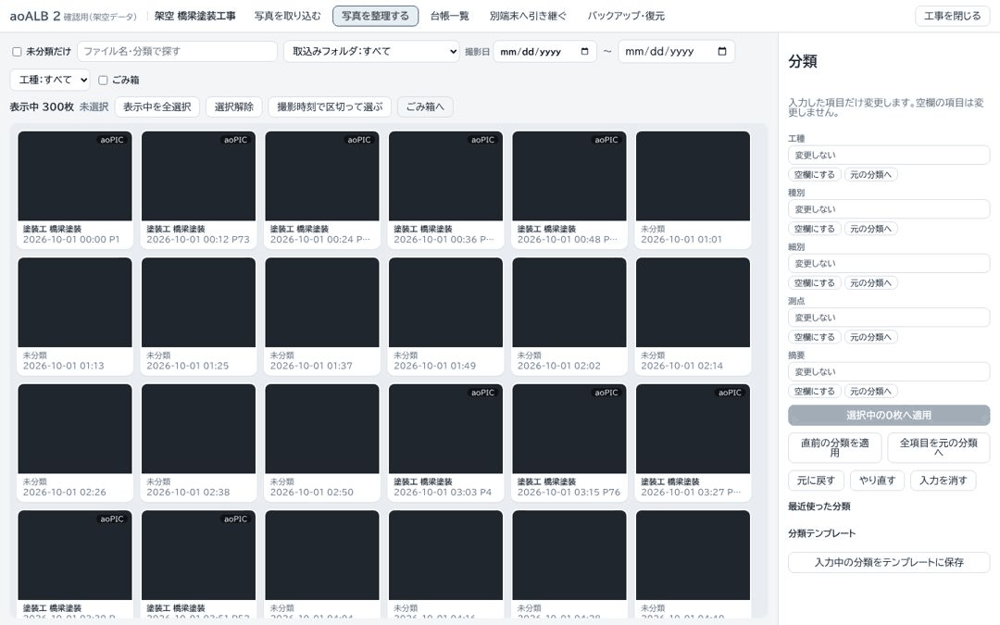
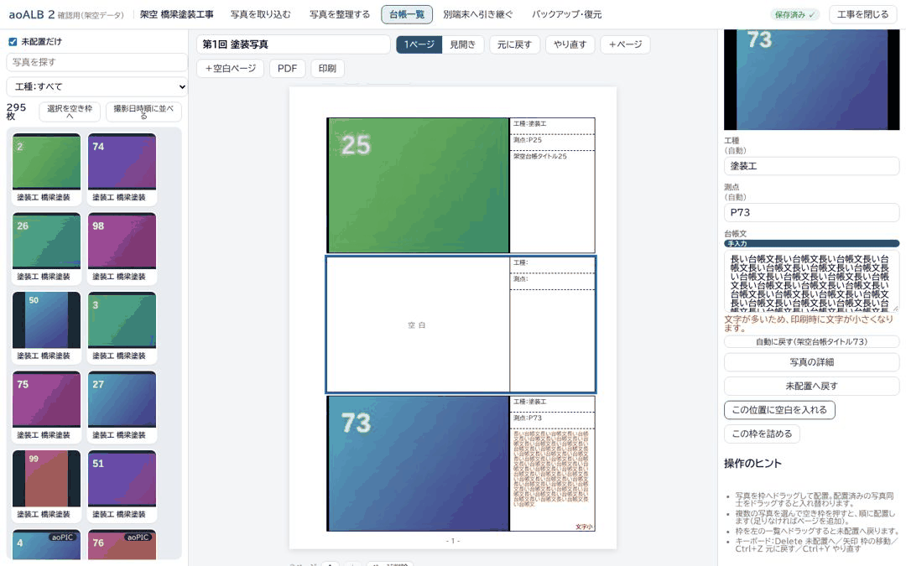
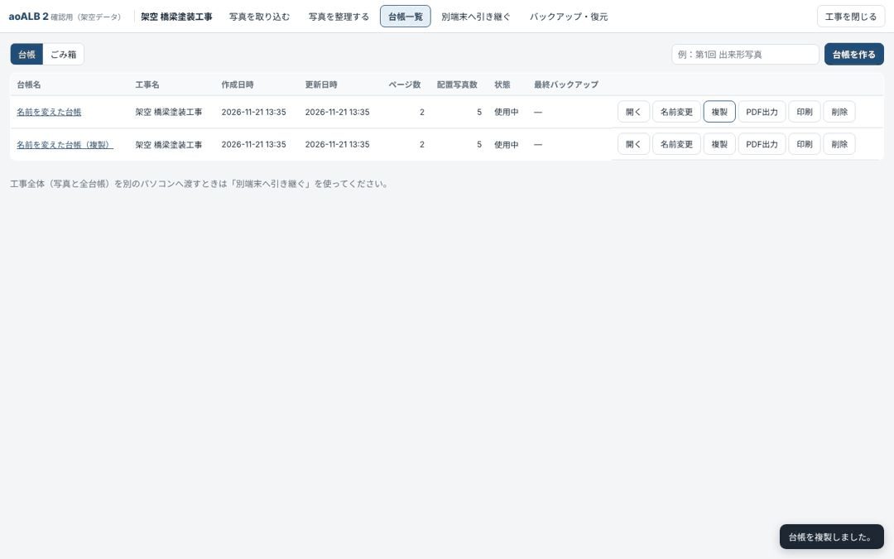
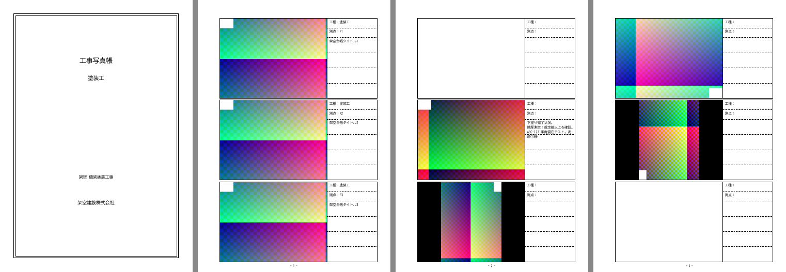

# 段階2 結果報告（最小動作プロトタイプ）

実施日：2026-11-21　使用データ：生成した架空写真・架空工事のみ
**追記（同日）**：レビュー指摘への修正と追加計測は [review-2026-11-21.md](review-2026-11-21.md) を参照。下表の数値のうち画面のメモリ・PDF・引継ぎは同資料の値が最新。
確認環境：Linux（中核の自動検証・性能計測、Chromeでの画面操作、WebKitGTK上でのアプリ起動）。**Windows実機での確認は未実施**（GitHub Actionsのワークフローを用意）。

## 1. できたこと

| 項目 | 状態 | 確認方法 |
|---|---|---|
| 工事作成（保存先フォルダ選択・同名工事・ロック） | 済 | 自動検証 |
| JPEG取込み（複数・フォルダ・通常ZIP・aoPIC連携ZIP・ドロップ） | 済 | 自動検証・画面 |
| 重複検出・失敗一覧・失敗分だけ再試行・キャンセル | 済 | 自動検証 |
| サムネイル（裏で作成・向き補正・再生成） | 済 | 自動検証 |
| 写真一覧（仮想スクロール・絞込み・複数選択・詳細） | 済 | 画面（3,000枚） |
| 分類（一括・空欄・元分類へ・テンプレート・最近使った分類・元に戻す/やり直す） | 済 | 自動検証・画面 |
| 台帳作成・名前変更・複製・削除（ごみ箱）・復元・完全削除 | 済 | 自動検証・画面 |
| 写真配置（選択→枠、ドラッグ、連続配置）・入替え・移動・未配置へ | 済 | 自動検証・画面 |
| 空白枠・空白ページ・ページ追加/削除/並べ替え・見開き・表紙・文言・長文警告・キーボード | 済 | 自動検証・画面 |
| 自動保存（まとめて保存・保存状態表示・再試行上限） | 済 | 自動検証・画面 |
| PDF（JPEG無変換・日本語フォント埋込み・向き補正・進捗・中止） | 済 | 自動検証・画像で目視 |
| 印刷 | PDFを開いて印刷する方式 | Windows実機は未確認 |
| 工事エクスポート／インポート（.aoalb、ZIP64、世代警告、置換・別工事） | 済 | 自動検証（4.3GBを含む） |
| バックアップ・検証・復元 | 済 | 自動検証 |

## 2. 自動検証

| 区分 | 件数 | 結果 |
|---|---|---|
| 中核（`cargo test -p aoalb_core`） | 21 | すべて合格（復元後の写真維持・未登録原寸の復旧を追加） |
| 4GB超の引継ぎ（`--ignored huge_exchange_over_4gb`） | 1 | 合格（4,583,385,984バイト） |
| 画面ロジック（`node --test`） | 6 | すべて合格 |
| 実ブラウザでの操作（Chrome、100／300／1,000／3,000枚） | 一連の操作 | すべて成功、画面のエラー0件 |
| アプリの起動（Tauri、Linux WebKitGTK） | 1 | 起動・設定作成・ホーム画面表示を確認 |

中核の検証項目：DB migration／SQLite整合性／原寸不変・SHA-256維持／aoPICメタデータ維持／分類変更・元分類への復帰・元に戻す／台帳名変更／配置・入替え・移動・空白・ページ操作／変更した枠だけ更新／失敗した操作のまとめ取消し／台帳削除後も写真維持・台帳復元・完全削除／異常終了後の確認と復旧／サムネイル再生成と向き／フォルダ移動後の再オープン／同名工事・二重起動防止／取込みキャンセル／同じ写真を別工事へ／ZIPの不正パス・圧縮爆弾／引継ぎ往復（分類・台帳・原寸の一致）／新しい編集がある端末への取込み警告／壊れたファイル・改ざん・不正パス・HTML・実行ファイル・新しい形式版の拒否／途中キャンセルで既存データ不変・完成ファイルを残さない／容量不足の日本語表示／バックアップ検証・復元・不正名拒否／ネットワーク部品なし・秘密情報なし／画面とのJSON形式の一致。

ログ：写真の内容・個人情報を出力する処理はない（エラーの詳細は画面に出さず、内部の診断欄だけ）。

## 3. 性能（架空データ、Linux 2コア）

中核（`aoalb-bench`。一般写真4000×3000と aoPIC写真1280×960を7:3で混在。時間はミリ秒）

| 項目 | 0枚 | 1枚 | 100枚 | 300枚 | 1,000枚 | 3,000枚 |
|---|---|---|---|---|---|---|
| 工事を開く | 0.8 | 0.9 | 1.7 | 1.7 | 2.9 | 10.5 |
| 写真一覧（初回／再表示） | 0.1 | 0.1 | 0.5／0.7 | 1.3／1.2 | 3.5／3.1 | 10.9／13.2 |
| 一般写真の取込み | — | — | 143 | 487 | 1,530 | 5,179 |
| aoPIC ZIPの取込み | — | 1.7 | 31 | 118 | 453 | 1,477 |
| サムネイル作成（裏・全件） | — | 16 | 2,557 | 7,690 | 26,058 | 89,160 |
| 分類変更（100枚／全件） | — | 0.1 | 1.9／2.4 | 2.4／6.5 | 2.2／19.2 | 2.3／75.7 |
| 1枚配置（更新した枠数） | — | 0.1 | 0.4（1枠） | 0.4（1枠） | 1.0（1枠） | 2.7（1枠） |
| 入替え（更新した枠数） | — | 0.2 | 0.2（2枠） | 0.4（2枠） | 1.0（2枠） | 7.7（2枠） |
| 連続20操作を1回で保存 | — | 1.1 | 1.0 | 1.4 | 1.7 | 3.6 |
| 台帳を開く | — | 0.0 | 0.1 | 0.3 | 0.7 | 2.5 |
| 台帳一覧（50冊） | — | 0.6 | 1.0 | 1.2 | 2.3 | 6.3 |
| PDF（全写真の台帳） | — | 6.5 | 75（35頁） | 220（101頁） | 1,027（335頁） | 2,077（1,001頁） |
| DBバックアップ | 3.1 | 6.4 | 7.0 | 7.1 | 16 | 65 |
| 引継ぎ書出し | 1.3 | 5.8 | 147 | 393 | 1,342 | 3,672 |
| 引継ぎ取込み | 4.5 | 13 | 193 | 470 | 1,645 | 5,208 |
| 中核のメモリ（最大） | 42MB | 44MB | 43MB | 43MB | 43MB | 82MB※ |

※3,000枚は計測用の写真生成を同じプロセスで行った分を含む（計測開始時点で79MB）。取込み・PDF・引継ぎの間の増加は数MB。
原寸のデコード：一覧・台帳・PDFでは0枚。サムネイル作成時だけ1枚ずつ（1/8に縮小して読む）。
I/O：PDF・引継ぎは原寸を1回ずつ読むだけ（例：1,000枚のPDFで読込み約400MB・書込み約405MB）。
架空JPEGは1枚約0.5MB。実写真（約5MB）では取込み・PDF・引継ぎは容量に比例して長くなる。

画面（Chrome、架空データ）

| 項目 | 100枚 | 300枚 | 1,000枚 | 3,000枚 |
|---|---|---|---|---|
| 一覧の初回表示 | 236ms | 225ms | 212ms | 270ms |
| 表示中のカード数（DOM） | 48 | 48 | 48 | 48（スクロール中最大78） |
| 表示中を全選択 | 28ms | 47ms | 38ms | 23ms |
| 一括分類（画面反映まで） | 54ms | 47ms | 68ms | 80ms |
| 連続配置（4枚、ページ追加含む） | 90ms | 79ms | 76ms | 77ms |
| ドラッグで配置・入替え | 反映は即時（マウス移動の再現時間込みで約0.3秒） ||||
| 画面のメモリ | 5MB | 5MB | 7MB | 13MB |

## 4. 未実装・未確認

- Windows実機での動作（インストール、WebView2、ファイル選択、ドロップ、PDF閲覧ソフトでの印刷、フォント埋込み）。GitHub Actions で自動検証とインストーラー作成まで行う設定は用意済み。
- 自動更新（署名鍵の管理が必要なため段階3以降）。コード署名（未署名のためWindowsの警告が出る）。
- HEIC・PNG（設計書7章の理由で見送り）。
- 現行aoALBの台帳データ（配置・文言）の移行ツール。
- 写真の完全削除（ごみ箱からの物理削除）。バックアップの整合を保つため現段階では作らない。
- 分割した引継ぎファイル（FAT32のUSBメモリ向け）。
- 撮影日時のまとまり選択の間隔変更、写真一覧のカード大きさの切替え。
- 台帳テンプレートの種類（1ページ3枠のみ）。

## 5. 残るリスク

| リスク | 内容 | 対応 |
|---|---|---|
| Windows実機差 | WebView2・ファイルロック・パス長・フォント・ウイルス対策ソフトの影響が未確認 | 段階3の最初にActions成果物で実機確認 |
| PDFのフォント | 収録外の文字（BMP外の漢字・絵文字・外字）は「〓」になる | 同梱フォントで対応済み。収録外は出力時に警告 |
| 巨大なPDF | 原寸を再圧縮しないため、実写真3,000枚で数GB〜15GBになる | 分割出力または印刷用縮小画像を段階3で検討 |
| 2台で同時に編集 | 自動マージしないため、片方の変更は手動で選ぶ必要がある | 取込み前の警告と置換前の全保存で保護済み。運用で「渡したら元の端末では編集しない」 |
| 大量の実写真 | 5MB×3,000枚＝約15GBで、取込み・引継ぎはディスク速度が上限 | 進捗・中止・再開あり。実測は段階3 |
| 未署名配布 | SmartScreenの警告 | 社内配布の手順書、または署名の検討 |
