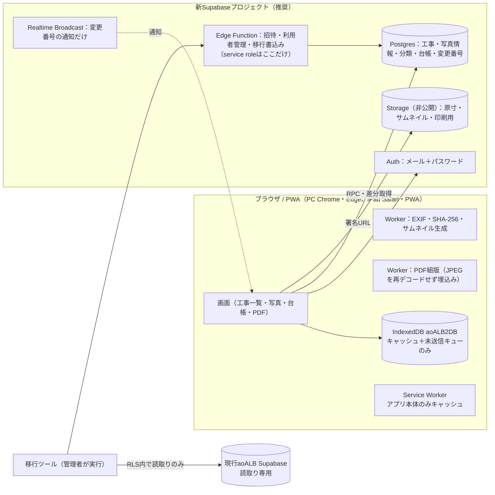
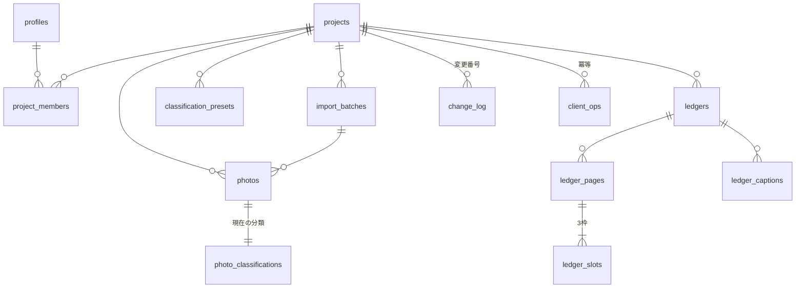
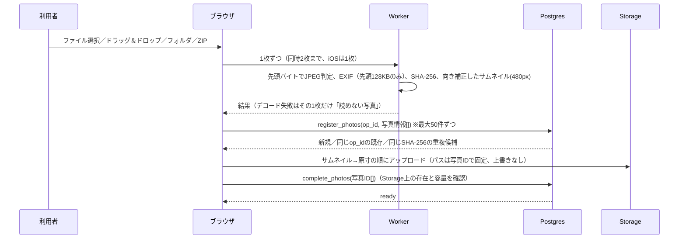

# aoALB 2 第2段階：設計

状態：**設計案（未承認・未実装・未適用）**。SQLは `sql/02-schema-draft.sql` に草案として置く。migrationではない。

## 1. システム構成



### 方針
- **クラウドが正本**。IndexedDBは「表示用キャッシュ」と「未送信操作キュー」だけ。消えても再ログインで復元。
- **別Supabaseプロジェクト**で新規構築（推奨）。現行プロジェクトに新スキーマを足す案は、本番変更禁止・CPU問題の切分け・Authセッション衝突の観点で不採用を推奨（未決事項2）。
- **別リポジトリ `aoALB2`**（推奨）または現行リポジトリの別ディレクトリ。同じ `aopen3024.github.io` オリジンで動くため、IndexedDB名・localStorageキー・Service Workerのscope・Supabaseセッションの保存キーを**現行aoALBと必ず分ける**（`aoALB2DB`、`storageKey: "aoalb2-auth"`、scope `/aoALB2/`）。Service Worker更新時にIndexedDBは削除しない。
- 技術用語・内部ID・内部エラーは通常画面に出さない。詳細は「管理者向け診断」画面に限定。

## 2. データモデル



| 表 | 主な列 | 要点 |
|---|---|---|
| `profiles` | user_id, display_name, status(invited/active/disabled), deleted_at | Authユーザーと1:1。匿名は作らない |
| `system_admins` | user_id, active | システム管理者（通常画面には出さない） |
| `projects`（工事） | id, name, kouji_code, contractor, status(active/closed/trashed), revision | 旧 site/project を1階層に |
| `project_members` | project_id, user_id, role(`admin`/`member`/`viewer`), active | 画面表示は「管理者／利用者（／閲覧のみ）」 |
| `photos` | id(UUIDv7・端末で採番), project_id, source(`aopic`/`camera`/`file`/`zip`/`migrated`), sha256, original_path, thumb_path, print_path, width, height, bytes, taken_at, taken_at_source(exif/file/aopic/manual), original_filename, folder_label, import_batch_id, aopic(jsonb：photoUid・boardSnapshot・分類原本・ledger), upload_state(registered/uploaded/ready), status(active/trashed), revision | **原寸・aoPIC情報は作成後に更新不可**（UPDATE権限を列単位で付与しない） |
| `photo_classifications` | photo_id, koushu, shubetsu, saibetsu, sokuten, tekiyo, source(aopic/manual/preset/migrated), revision, updated_by | 「現在の分類」。aoPIC原本は `photos.aopic` に残る |
| `classification_presets` | project_id, name, values(jsonb) | 現場ごとのプリセット |
| `classification_terms` | project_id, field, value, use_count, last_used_at | 候補履歴（入力補完） |
| `import_batches` | id, project_id, created_by, source_kind, total, accepted, rejected, duplicates, status | 取込みの単位。「一部失敗」を利用者へ説明する根拠 |
| `ledgers` | id, project_id, title, template, cover(jsonb), view_mode, status(active/trashed), revision | 台帳単位のrevision |
| `ledger_pages` | id, ledger_id, sort_key(text, 分数インデックス), status, revision | 途中挿入で後続ページを書き換えない |
| `ledger_slots` | id, page_id, ledger_id, slot_index(0..2), kind(`empty`/`photo`/`blank`), photo_id, revision | **部分一意索引 `(ledger_id, photo_id) where photo_id is not null`** で重複を索引1回で防止 |
| `ledger_captions` | ledger_id, photo_id, caption(jsonb), revision | 未配置へ戻しても保持（現行仕様を継承） |
| `change_log` | seq(bigserial), project_id, entity, entity_id, revision, op, actor, at | **差分取得の基準**。90日保持 |
| `client_ops` | op_id(PK), project_id, user_id, kind, result(jsonb), at | **冪等性**。同じop_idの再送は前回結果を返す。30日保持 |
| `audit_logs` | 操作者・操作・対象・要約 | 秘密値・メール本文・PASSを保存しない。1年保持（要決定） |

削除は全てソフト削除（`status`）。物理削除は「ごみ箱を空にする」を管理者だけが、件数確認つきで実行（Edge Function経由でStorageと同時に）。台帳削除は台帳の `status=trashed` のみで、ページ・枠・文言・写真は残す（現行の物理削除は是正）。

## 3. 認証・権限

### 利用者から見える流れ
1. 管理者が「利用者を招待」→ メールアドレスと表示名、工事、役割（管理者／利用者）を入力
2. 利用者は招待メールのリンクで**パスワードを設定**
3. 以後はメールアドレス＋パスワードでログイン。ログイン状態は保持
4. ログイン後は**所属工事一覧**。工事を選ぶと写真・台帳へ
5. 画面上部に常に「ログイン中：表示名」「工事名」「権限：利用者」を表示

ブラウザ（Chrome／Edge／iPad Safari／iPadのホーム画面アプリ）ごとに最初の1回だけログインが必要。データはクラウドにあるため、どこでログインしても同じ状態になる。この点を最初の画面で説明する。

### 内部の権限
| 内部 | 画面表示 | できること |
|---|---|---|
| system_admin | （管理画面のみ） | 工事作成、全利用者管理、移行実行 |
| project admin | 管理者 | 工事の利用者招待・停止、ごみ箱を空にする、工事を閉じる |
| project member | 利用者 | 写真取込み・分類・台帳編集・PDF（標準） |
| project viewer | 閲覧のみ | 閲覧・PDF（採用は未決事項4） |

- 工事作成は当面システム管理者のみ（会社PASS廃止の代替）。会社単位テナントはMVP外。
- パスワード再設定：ログイン画面の「パスワードを忘れた」。
- 認証エラーは「メールアドレスかパスワードが違います」「ログインの有効期限が切れました。もう一度ログインしてください」等に変換。PKCE・JWT等は表示しない。
- 自由サインアップは無効、匿名サインインは無効。

### RLSの設計（候補Dの是正）
```sql
-- 所属工事IDを1文につき1回だけ計算（initPlan）
create function private.my_project_ids(p_min text default 'viewer') returns uuid[] ...;
create policy photos_select on photos for select to authenticated
  using (project_id = any ((select private.my_project_ids('viewer'))));
```
- `my_project_ids` 内で「アカウントがactive」「工事がactive」「所属がactive」を1回で判定。
- 書込みは原則RPC経由（SECURITY DEFINER、`search_path=''`、`authenticated` のみEXECUTE）。表への直接INSERT/UPDATEは許可しない。
- 全外部キー列・`project_id` 列にインデックス。

## 4. 写真取り込みフロー



- 対応：ファイル選択（複数）、ドラッグ＆ドロップ、フォルダ（`webkitdirectory`対応ブラウザ）、iPhone・iPadの写真選択、SD／デジカメからPCへコピーしたJPEG、aoPIC JPEG、aoPIC連携ZIP、通常ZIP。
- ZIPは**ストリーミング展開**（1エントリずつ取り出して処理・解放）。ZIP全体をメモリへ展開しない。
- aoPIC判定：連携ZIPの `manifest.json`、または単体JPEGの場合は `photoUid` 等が取れれば紐付け（取れなければ一般写真）。いずれもSHA-256を照合。
- 撮影日時：EXIF `DateTimeOriginal`（＋OffsetTime）→ なければファイル更新日時を「候補」として記録（`taken_at_source=file`、画面で「撮影日時不明（ファイル日時）」と表示）。
- 重複：同じ工事に同じSHA-256があれば「同じ写真がすでにあります（○月○日取込み）」と案内し、**取り込む／飛ばす**を選ばせる（既定は飛ばす）。自動削除しない。ファイル名では判定しない。
- 一部失敗：取込み結果画面で「取り込んだ○枚／重複で飛ばした○枚／読めなかった○枚」を一覧表示。成功分は確定し、失敗分だけ再試行可能。
- 中断・再開：取込み待ちの写真は `IndexedDB` の送信キューへBlobごと保存（ディスク上、メモリではない）。再開時は送信済みを `op_id`・写真IDで判定して残りだけ送る。キュー容量は上限（例：2GB、端末の空き容量で調整）を超えると取込みを一時停止して案内。
- 冪等性：写真IDとop_idは端末で先に採番。同じファイルを再送してもStorageは同じパス（上書き不可）、DBは同じop_idで既存結果を返す。
- HEIC・PNG：MVPはJPEGのみ。iPhone・iPadの写真選択はSafariが多くの場合JPEGへ変換して渡す。HEICの直接対応（WebAssembly変換）はメモリ・画質・EXIF維持の検証後に判断（未決事項6）。
- 印刷用画像：aoPIC写真（≤500KB）は原寸をそのまま使用。デジカメ等の大きい写真は**原寸は不変で保持**し、長辺2,000px程度の印刷用JPEGを別に作成する案（未決事項5）。

## 5. 写真分類フロー

- aoPIC写真：取込み時に `photos.aopic`（不変）と `photo_classifications`（現在値、source=aopic）を作成。分類変更は `photo_classifications` だけを更新し、元JPEG・黒板・boardSnapshot・photoUid・SHA-256は変更しない。
- 一般写真：未分類で取り込み、一覧の上部に「未分類 ○枚」を常時表示。

省力化（必須機能を全て含む）：
| 機能 | 操作 |
|---|---|
| 撮影日時で自動グループ化 | 撮影間隔が一定時間（既定20分、変更可）以上空いたら区切る。グループ見出しのチェックで一括選択 |
| フォルダ名でグループ化 | フォルダ取込み・ZIP時のフォルダ名を `folder_label` に記録 |
| ファイル名で絞り込み | 検索欄 |
| 未分類だけ表示 | 絞込み切替 |
| 選択写真へ一括適用 | 右パネルで5項目を入力し「選択中○枚へ適用」 |
| 一部項目だけ変更 | 空欄の項目は変更しない（「この項目を空にする」は明示操作） |
| 直前の分類を適用 | ボタン1つ |
| 現場ごとのプリセット | 保存・呼出し |
| 候補履歴 | 各項目の入力補完（工事内の使用回数順） |
| 元に戻す／取り消し | 一括適用は1操作として取消し可能（変更前の値を操作キューに保持） |

一括分類はRPC `classify_photos(op_id, photo_ids[], patch, expected_revisions)` で1往復。revisionが合わない写真だけ競合として返す。

将来案（MVP外）：黒板OCR・画像AIの候補提示（自動確定しない、外部送信は事前に明示）、物理黒板のQRコード読取り（端末内で読取り可能で外部送信が不要な点が有利。比較は `03-migration-and-plan.md` 付録）。

## 6. 台帳編集

### 画面
```
┌ 工事名 ＞ 台帳名 [保存済み ✓] ─────────────── [1頁|見開き] [元に戻す][やり直す] [PDF] ┐
├ 写真一覧（仮想スクロール） ┬ 台帳ページ（表示範囲だけ描画） ┬ 右パネル ─────────┤
│ 絞込み：分類・未配置・日付  │  ┌───┐ 右欄文言               │ 選択中の写真／枠    │
│ □□□□（選択は枠色＋✓）   │  │写真│                         │ 分類・撮影日時      │
│ ドラッグ→台帳へ            │  └───┘                         │ 右欄文言の編集      │
│ 選択○枚→「空き枠へ配置」   │  ＋空白枠 ＋ページ               │ 台帳設定・表紙      │
└────────────────────┴──────────────────┴────────────┘
```
- iPad縦（768px）：写真一覧を下部ドロワー、右パネルをシートに。390px：閲覧・分類中心、配置は「選択→枠をタップ」。
- 選択状態は枠色・チェック・件数バッジで常に見える。「選択中○枚」をヘッダーに表示。

### 操作（必須を全て含む）
写真ドラッグで配置／選択→空き枠タップで配置／複数選択→「先頭の空き枠から順に配置」／**配置済み同士をドラッグで交換**（1操作）／空白枠の挿入・削除／未配置へ戻す／ページ追加・削除／台帳名・表紙・右欄文言編集／分類で絞込み／撮影日時順の自動配置／1頁・見開き／元に戻す・やり直す／台帳一覧・複製・削除（写真は削除しない）／PDF・印刷。

### 保存方式
- 操作は全て「台帳操作（op）」として表現：`place`, `swap`, `clear`, `insert_blank`, `remove_slot`, `add_page`, `delete_page`, `move_page`, `set_caption`, `set_meta`。
- 画面は即時反映（楽観的更新）。opはIndexedDBの台帳別キューへ追記。
- **700ms**（500〜1,000msの範囲で調整）操作が止まったら、キューのopを**1回のRPC** `apply_ledger_ops(ledger_id, base_revision, ops[], op_id)` で送信。
- 同じ台帳の送信は**常に1本だけ**。送信中に増えたopは次の送信へまとめる（現行の自己競合を構造的に解消）。
- サーバーは影響する枠・ページだけを更新し、新しい台帳revisionと変更した枠のrevisionを返す。`change_log` に1行。
- 競合：base_revisionが古い場合、サーバーはopごとに対象枠のrevisionを照合し、**対象が他人に変更されていないopは適用**、変更されていたopだけ返す。返されたopは「別の端末で同じ枠が変更されました」と表示し、「相手の変更を残す／自分の変更で上書き／両方残す（自分の版を複製台帳へ）」を選ばせる。黙って上書きしない。
- 元に戻す：クライアントが逆操作opを生成して送る（サーバー履歴を巻き戻さない）。

### 保存状態表示（ヘッダー）
| 表示 | 意味 |
|---|---|
| 保存済み ✓ | 全てクラウドに保存 |
| 保存中… | 送信中 |
| この端末に保存済み（未送信 ○件） | オフライン等。自動で再送 |
| 保存できていません［再試行］ | 再試行上限に到達。操作内容は端末に残っている |
| 競合があります［確認］ | 利用者の判断待ち |

「写真を選べない」は保存状態と別の場所（写真一覧側）に表示し、保存失敗と混同させない。

## 7. 同期・Realtime

- 1工事につき**1チャンネル**（Realtime Broadcast、非公開チャンネル、RLSで所属工事のみ参加可）。
- チャンネルで流すのは `{seq}` だけ。受信した端末は `get_changes(project_id, since_seq, limit 500)` で**差分だけ**取得し、該当する写真・枠・台帳だけ更新。
- **自分のop_idによる変更は再取得しない**。
- 通知は300msまとめてから1回だけ差分取得（取込み中の連続通知を吸収）。
- 工事切替・ログアウト・画面破棄時に必ず購読解除。購読管理はモジュール1箇所に集約し、購読数を診断画面で確認可能にする。
- Realtimeが使えない／切断中：画面復帰（`visibilitychange`）・オンライン復帰・手動「最新にする」で `get_changes` を実行。`since_seq` が保持期間（90日）より古い場合だけ全件再取得。
- 送信キューは「工事＞台帳／写真」単位で統合。同じエンティティの未送信変更は1件にまとめる。

## 8. オフライン設計

| 操作 | オフライン時 |
|---|---|
| 写真一覧・サムネイル表示 | キャッシュ済みの範囲で可 |
| 分類変更・台帳編集 | 可（キューへ保存、復帰時に送信） |
| 写真取込み | 端末内の処理まで可。アップロードは復帰後 |
| PDF | キャッシュ済みの原寸／印刷用画像が揃っている台帳のみ可。不足があれば枚数を表示 |
| 利用者管理・ごみ箱を空にする・台帳削除 | 不可（オンライン必須と表示） |

IndexedDB（`aoALB2DB`）のストア：`thumbCache`（LRU、上限例200MB）、`printCache`（LRU、上限例500MB）、`metaCache`（工事ごとの最終seqと一覧データ）、`opQueue`、`uploadQueue`、`settings`。容量は `navigator.storage.estimate()` で確認し、`navigator.storage.persist()` を要求。

## 9. エラー回復設計

- 再送：指数バックオフ（1, 2, 4, 8, 16, 32, 60秒、±20%ジッタ）。同じエラーが連続5回で自動再送を止めて「保存できていません［再試行］」。無限再試行しない。
- 分類：ネットワーク系（再送）／権限（再送しない・「この工事を編集する権限がありません」）／競合（利用者判断）／入力不正（再送しない・該当項目を表示）／サーバー側一時障害（再送）。
- 未送信キューは利用者が明示的に破棄しない限り消さない。ログアウト時に未送信があれば警告。
- アプリ更新時：キューの形式にバージョンを持たせ、変換できない場合は破棄せず「旧形式の未送信データ」として保持し管理者向け診断で書き出せるようにする。

## 10. 性能設計

- 写真一覧：**仮想スクロール**（表示行＋前後1画面分だけDOM化）。1,000〜3,000枚でもDOMは100要素程度。
- 画像：サムネイル（480px、30〜60KB）のみ。`createSignedUrls` を表示範囲単位でまとめて発行（1回最大100件）。Object URLは表示範囲から外れたら `revoke`。同時保持数に上限（例：300）。
- 原寸：詳細表示・PDF時だけ1枚ずつ取得し、使用後すぐ解放。
- サムネイル生成・ハッシュ：Worker、同時2（iOSは1）。`createImageBitmap(..., {resizeWidth})` 対応環境はデコードと縮小を同時に。
- 台帳プレビュー：表示中のページ＋前後1ページだけ描画。操作時は変更枠だけ再描画（全体再描画しない）。
- PDF：Workerで `pdf-lib` を使用し、**JPEGバイト列をそのまま埋め込む**（デコード不要でメモリ消費が小さい）。1ページずつ画像を取得→埋込み→参照解放。日本語フォントはサブセット埋込み（字形はサブセット化処理の検証が必要）。印刷は生成したPDFを開いて行う（ブラウザ印刷で全画像を同時ロードしない）。
- 一覧データ：1工事3,000枚でも写真メタデータは約1〜2MB。初回は200件単位のページングで取得し、以後は差分のみ。
- DB：全RPCは対象工事・対象台帳の範囲だけを触る。全台帳一括取得RPCは作らない。

性能目標（第3段階プロトタイプで計測）：
| 指標 | 目標 |
|---|---|
| 写真選択の見た目の反応 | 50ms以内 |
| 台帳配置・交換の反映 | 100ms以内（通信を待たない） |
| 1,000枚一覧の初期表示 | 2秒以内（キャッシュあり）、Wi-Fi初回5秒以内 |
| スクロール | iPadで目立つカクつきなし（長タスク50ms超を記録） |
| Object URL保持数 | 常時300以下 |
| PDF 100ページ（aoPIC写真） | iPadでメモリ不足なく完走 |
| 保存1回のDB時間 | 50ms以内（op 20件程度） |

## 11. セキュリティ設計

- Storage非公開。パス `{project_id}/{o|t|p}/{photo_id}.jpg`。読取りポリシーは「フォルダの工事IDが所属工事に含まれる」かつ「パス中の写真IDの `photos` 行が `active`（主キー1件照合）、またはadmin」。現行の「ごみ箱の写真はadmin以外読めない」保護を維持しつつ全件走査をなくす。
- アップロードは `insert` のみ許可（上書き・削除不可）。削除はEdge Function（管理者・件数確認つき）。
- ブラウザに置くのはURLとPublishable keyのみ。service roleはEdge Functionの環境変数だけ。
- SECURITY DEFINER関数は `set search_path = ''`、`revoke all from public, anon` → `grant execute to authenticated`。
- 監査ログ：操作者・操作・対象ID・件数のみ。メールアドレス本文・PASS・トークンは保存しない。
- 写真・台帳の物理削除は通常画面に置かない。
- revisionによる競合防止、ソフトデリートと復元。
- 招待・利用者停止はEdge Functionでレート制限と監査記録（現行 `account-admin` の考え方を継承）。
- 現行システムのセキュリティを弱める変更は含めていない（Storageのごみ箱保護、所属による制限、activeアカウント限定を維持）。
